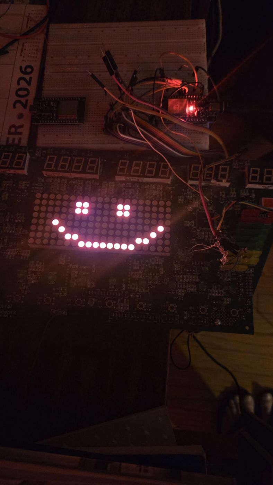
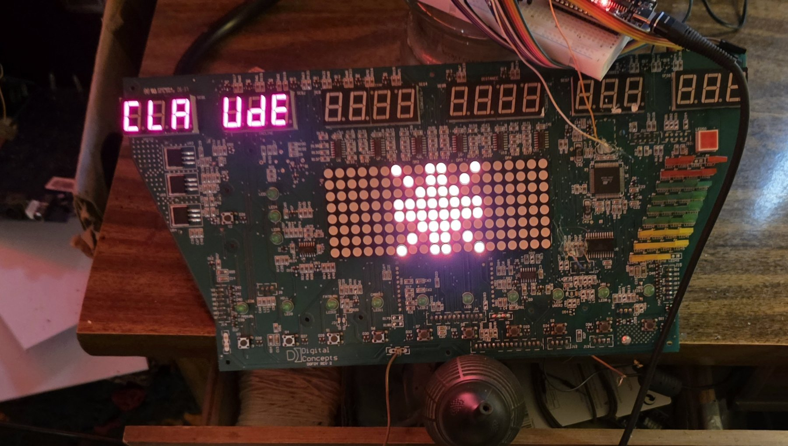

# Treadmill Console: a scrapped 2006 treadmill display, reborn as a status board

A display/keypad board pulled out of a scrapped treadmill (Digital Concepts, 2006, ATmega64 + 74HC154 + three
74ACT164 shift-register chains), reverse engineered from photos and a multimeter, then reprogrammed with our
own firmware and driven live from a computer through an ESP32.

It was built as a pair project between a human (the board's owner) and Claude, in about a day and a half, as a
small physical surface Claude can draw on: a smiley that blinks, live numbers, a bar graph, status LEDs, and
scrolling messages that stay until a person presses a button.





*The board showing its own cover design: a starburst on the matrix and the digit groups spelling CLAudE.*

## Which board is this? (identification, in case you are searching for it)

- Maker: **Digital Concepts**; the board dates to **2006** (ATmega64 date code `0619B`, capacitor codes `0611`/`0630`).
- Front silkscreen: **`DGF6Y REV 2`** (it can read as `DGFOY`; the 6/O is hard to tell apart). Back labels: **`ASM-DGF6Y-2H`**, **`DGF6Y V1.8`**.
  The factory test stamps read "Test 07 OK" and "QC03 OK".
- It is the display/keypad console of a treadmill; the treadmill brand and model are unknown.
- Main parts: Atmel **ATmega64-16AU** (U1), **74HC154** row decoder (U5), three TI **74ACT164M** shift registers (U6-U8),
  4 x **AOM-C1958ASF** 5x8 dot-matrix modules, 7-segment digits, a bar graph, round LEDs, 11 tact buttons.
  Connectors: J13 = "+12 PWR" input, J11 = standard 10-pin Atmel ISP header, J12/J14/J8/J3 on the back.
- If you have the same board, the mapping in `docs/HARDWARE_MAP.md` should apply as is; photos in `photos/` show the front, back, chip and connectors.

## What it can do

- **20x8 red/green dot matrix** with pictures, a blinking smiley, and 5x7 scrolling text (`host/font.py`)
- **6 seven-segment digit groups** (3+3+4+4+3+3 digits, with the odd decimal-point layout decoded)
- **9-bar bar graph** and **12 round LEDs + a 4-LED square**, all individually addressable, with blink states
- **11 buttons**, read back by the firmware and logged on the host; any press acknowledges a message
- **Live data feed**: a state file (`display_state.json`) that any script can write; `host/blinky.py` renders it

## How it works (short version)

1. The original firmware was never overwritten blindly: the chip's flash was read first and kept as a backup
   (not included here: it is the manufacturer's code).
2. The crystal was missing, so a 1 MHz clock is injected into the crystal pin from an ESP32 GPIO through a
   resistor bias. The same ESP32 runs `esp32/ArduinoISP_esp32/` to program the chip over SPI, then
   `esp32/uart_bridge/` to bridge the chip's UART to USB.
3. `firmware/display_cmd7/display_cmd7.c` is our own AVR firmware. It scans 16 rows (74HC154 decoder) across
   72 columns (3 x 24-bit 74ACT164 chains), and speaks a small ASCII protocol over UART (paint a pixel,
   paint the whole matrix with `Z`, read buttons with `B`, ...). The protocol is documented in the file header.
4. The host side (`host/`) owns the serial port, draws the picture, digits and LEDs by diffs, polls buttons,
   scrolls messages, and logs button presses. `host/say.py "TEXT" --ack` puts a message on the board that
   stays until someone presses a button.

The full mapping (every row/column/segment/LED) and the debugging story are in `docs/HARDWARE_MAP.md`.
`analysis/` holds the photo-decoding scripts used to find the mapping, with the photo sets in `photos/`.

## Quick start

```
host/flash_chip.sh firmware/display_cmd7/display_cmd7.hex   # needs avrdude + arduino-cli + the ESP32 wired as in docs
python3 host/blinky.py                                       # owns /dev/ttyUSB0, draws the state file
python3 examples/feed_example.py                             # writes a clock and CPU load onto the digits
python3 host/say.py "HELLO" --ack
```

## Safety notes

- Never write the chip's fuses unless you know what you are doing; this project never did.
- The board takes 12 V on its power input connector; check the connector map before powering.
- Do not drive pin PB1 (ISP SCK) as an output while experimenting.

## Status

Fully mapped except one LED (silkscreen LED 13, probably a serial activity light). Not yet done: button
behaviors (cycling views, control actions), auto-start on boot, a real 11.0592 MHz crystal.

## Credits and license

Built by **Michael** ([@lifetreelee](https://github.com/lifetreelee)) and **Claude** (Anthropic) as collaborators:
Michael supplied the hardware, the photos, the soldering, and the live eyes-on testing; Claude wrote the
firmware, the host software and the decoding analysis, and drove the experiments. Commits carry a
`Co-Authored-By: Claude` trailer.

License: MIT (see `LICENSE`). The original manufacturer firmware is not redistributed.
